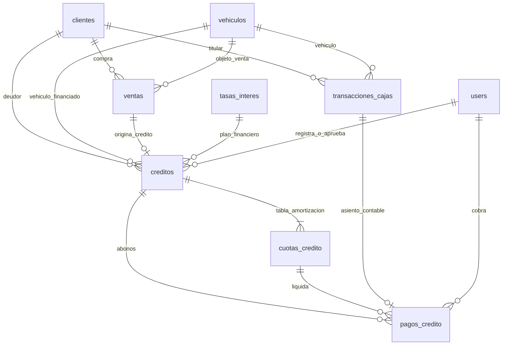

# Documentación Técnica — Módulo de Créditos, Amortización y Cobranzas (Optimus ERP)

Esta guía documenta la arquitectura normalizada de base de datos, modelos Eloquent, flujo operativo desde `/mis-ventas/{id}`, integración contable con Caja y reglas de seguridad para el almacenamiento privado de documentos del módulo de **Créditos, Amortización y Cobranzas**.

---

## 1. Diagrama Entidad-Relación (Esquema Normalizado)



---

## 2. Estructura de Base de Datos

**Migración principal:** `database/migrations/2026_11_25_114500_create_creditos_amortizacion_cobranzas_schema.php`  
**Seeder de catálogo:** `database/seeders/TasaInteresSeeder.php` (registrado en `DatabaseSeeder.php`)

### 2.1 Llaves primarias reales de tablas existentes vinculadas
| Tabla existente | Llave primaria real | Tipo |
| :--- | :--- | :--- |
| `clientes` | `id_cliente` | `unsignedBigInteger` |
| `ventas` | `id_venta` | `unsignedBigInteger` |
| `vehiculos` | `id_vehiculo` | `varchar(20)` (placa normalizada) |
| `transacciones_cajas` | `id_transaccion` | `unsignedBigInteger` |
| `users` | `id` | `unsignedBigInteger` |

> **Ajustes de compatibilidad aplicados en la migración:**
> - `clientes`: `cedula` ampliada a `varchar(30)` (evita desbordamiento de `INT` en cédulas ecuatorianas de 10 dígitos), y `apellido`, `telefono`, `correo`, `direccion` configurados como `nullable`.
> - `transacciones_cajas`: `id_cliente` convertido a `nullable` y `monto` ampliado a `decimal(15, 2)` para soportar asientos de cobro inmediatos antes de emitir la constancia del comprador.

---

### 2.2 Tabla `tasas_interes` (Catálogo financiero)
Almacena los planes y tasas configurables del concesionario, diferenciando explícitamente la **Tasa Nominal Anual (TNA)** y la **Tasa Efectiva Anual (TEA)** conforme a la normativa financiera ecuatoriana (BCE).

| Columna | Tipo | Restricciones / Descripción |
| :--- | :--- | :--- |
| `id_tasa_interes` | `BIGINT UNSIGNED` | PK autoincremental |
| `nombre` | `VARCHAR(120)` | Nombre comercial del plan |
| `descripcion` | `VARCHAR(255)` | Nullable. Detalle del plan |
| `tasa_anual` | `DECIMAL(6,2)` | Tasa anual de compatibilidad (equivalente a `tasa_nominal_anual`) |
| `tasa_nominal_anual` | `DECIMAL(6,2)` | **TNA**: `tasa_mensual × 12` sin capitalización (default `0.00`) |
| `tasa_efectiva_anual` | `DECIMAL(6,2)` | **TEA**: `((1 + tasa_mensual/100)^12 - 1) × 100` con capitalización mensual (default `0.00`) |
| `tasa_mensual` | `DECIMAL(6,4)` | Porcentaje mensual (default `0.0000`) |
| `tasa_mora` | `DECIMAL(6,2)` | Porcentaje de mora (default `0.00`) |
| `plazo_minimo_meses` | `SMALLINT UNSIGNED` | Plazo mínimo permitido en meses |
| `plazo_maximo_meses` | `SMALLINT UNSIGNED` | Plazo máximo permitido en meses |
| `activo` | `BOOLEAN` | Estado activo/inactivo (default `true`) |
| `created_at` / `updated_at` | `TIMESTAMP` | Marcas de tiempo |

**Planes precargados (`TasaInteresSeeder`):**
- **Crédito Directo Corto Plazo (0% Interés):** `0.00%` mensual · TNA `0.00%` · TEA `0.00%` · Mora `3.00%` (1–6 meses).
- **Financiamiento Preferencial (> 6 meses):** `1.00%` mensual · TNA `12.00%` · TEA `12.68%` · Mora `4.00%` (7–36 meses).
- **Financiamiento Optimus Estándar (> 6 meses):** `1.30%` mensual · TNA `15.60%` · TEA `16.77%` · Mora `5.00%` (7–48 meses).

---

### 2.3 Tabla `creditos` (Cabecera del financiamiento)
Extiende la tabla `creditos` preservando compatibilidad total con los créditos de adquisición (`validacion_documento_id != null`, `id_venta = null`).

| Columna | Tipo | Restricciones / Descripción |
| :--- | :--- | :--- |
| `id_credito` | `BIGINT UNSIGNED` | PK autoincremental |
| `validacion_documento_id` | `BIGINT UNSIGNED` | Nullable, FK → `validacion_documentos.id` (`nullOnDelete`) |
| `id_cliente` | `BIGINT UNSIGNED` | Nullable, FK → `clientes.id_cliente` (`nullOnDelete`) |
| `id_venta` | `BIGINT UNSIGNED` | Nullable, FK → `ventas.id_venta` (`cascadeOnDelete`) |
| `id_vehiculo` | `VARCHAR(20)` | Nullable, FK → `vehiculos.id_vehiculo` (`nullOnDelete`) |
| `id_tasa_interes` | `BIGINT UNSIGNED` | Nullable, FK → `tasas_interes.id_tasa_interes` (`nullOnDelete`) |
| `user_id` | `BIGINT UNSIGNED` | Nullable, FK → `users.id` (`nullOnDelete`, quien registra/aprueba) |
| `monto_total` | `DECIMAL(15,2)` | Precio final de venta acordado |
| `monto_inicial` | `DECIMAL(15,2)` | Entrada / monto inicial (default `0.00`) |
| `monto_financiado` | `DECIMAL(15,2)` | `monto_total - monto_inicial` |
| `saldo_pendiente` | `DECIMAL(15,2)` | Saldo exigible restante de las cuotas |
| `numero_cuotas` | `SMALLINT UNSIGNED` | Total de cuotas pactadas |
| `fecha_inicio` | `DATE` | Fecha de apertura del crédito |
| `fecha_vencimiento` | `DATE` | Nullable (compatibilidad con créditos de compra) |
| `fecha_vencimiento_final` | `DATE` | Fecha de vencimiento de la última cuota |
| `ruta_pagare` | `VARCHAR(255)` | Nullable. Ruta en disco **privado** `local` al pagaré `.docx` |
| `estado` | `VARCHAR(40)` | `pendiente_aprobacion_credito`, `activo`, `en_mora`, `cancelado` |
| `observaciones` | `TEXT` | Nullable |
| `registrado_por` | `BIGINT UNSIGNED` | Nullable, FK → `users.id` (`nullOnDelete`) |

---

### 2.4 Tabla `cuotas_credito` (Tabla de amortización detallada)
| Columna | Tipo | Restricciones / Descripción |
| :--- | :--- | :--- |
| `id_cuota_credito` | `BIGINT UNSIGNED` | PK autoincremental |
| `id_credito` | `BIGINT UNSIGNED` | FK → `creditos.id_credito` (`onDelete('cascade')`) |
| `numero_cuota` | `SMALLINT UNSIGNED` | Número secuencial (`UNIQUE(id_credito, numero_cuota)`) |
| `fecha_vencimiento` | `DATE` | Fecha programada de pago |
| `monto_capital` | `DECIMAL(15,2)` | Porción de capital de la cuota |
| `monto_interes` | `DECIMAL(15,2)` | Porción de interés financiero |
| `monto_mora` | `DECIMAL(15,2)` | Recargo por mora (default `0.00`) |
| `valor_cuota` | `DECIMAL(15,2)` | Valor pactado de la cuota (`capital + interés`) |
| `monto_pagado` | `DECIMAL(15,2)` | Acumulado pagado de esta cuota |
| `fecha_pago_real` | `DATE` | Nullable. Fecha real del último pago aplicado |
| `estado` | `VARCHAR(30)` | `pendiente`, `parcial`, `pagada`, `vencida` |

---

### 2.5 Tabla `pagos_credito` (Cobranzas, comprobantes privados y vínculo con Caja)
| Columna | Tipo | Restricciones / Descripción |
| :--- | :--- | :--- |
| `id_pago_credito` | `BIGINT UNSIGNED` | PK autoincremental |
| `id_credito` | `BIGINT UNSIGNED` | FK → `creditos.id_credito` (`cascadeOnDelete`) |
| `id_cuota_credito` | `BIGINT UNSIGNED` | Nullable, FK → `cuotas_credito.id_cuota_credito` (`nullOnDelete`) |
| `id_transaccion_caja` | `BIGINT UNSIGNED` | Nullable, FK → `transacciones_cajas.id_transaccion` (`nullOnDelete`) |
| `user_id` | `BIGINT UNSIGNED` | Nullable, FK → `users.id` (`nullOnDelete`) |
| `monto_pagado` | `DECIMAL(15,2)` | Valor abonado |
| `metodo_pago` | `VARCHAR(30)` | `efectivo`, `transferencia`, `cheque`, `deposito` |
| `numero_referencia` | `VARCHAR(100)` | Nullable. Número de transferencia/cheque/depósito |
| `fecha_pago` | `DATE` | Fecha del abono |
| `ruta_comprobante` | `VARCHAR(255)` | Nullable. Ruta en disco **privado** `local` |
| `observaciones` | `TEXT` | Nullable |

---

## 3. Modelos Eloquent y Aislamiento con Inventario

| Modelo | Archivo | Relaciones principales |
| :--- | :--- | :--- |
| `TasaInteres` | `app/Models/TasaInteres.php` | `creditos()` |
| `Credito` | `app/Models/Credito.php` | `cliente()`, `venta()`, `vehiculo()`, `tasaInteres()`, `usuario()`, `registrador()`, `cuotas()`, `pagos()` |
| `CuotaCredito` | `app/Models/CuotaCredito.php` | `credito()`, `pagos()` |
| `PagoCredito` | `app/Models/PagoCredito.php` | `credito()`, `cuota()`, `transaccionCaja()`, `usuario()` |
| `Venta` | `app/Models/venta.php` | `credito()` (`hasOne` último crédito de la venta) |
| `Vehiculo` | `app/Models/vehiculo.php` | `credito()` (filtrado `whereNull('id_venta')` para compras), `creditoVenta()` (`whereNotNull('id_venta')`), `creditos()` |
| `Transacciones_caja` | `app/Models/transacciones_caja.php` | `vehiculo()`, `tipo_transaccion()`, `user()`, `metodo_pago()`, `cliente()` |

> **Aislamiento con Inventario:** `Vehiculo::credito()` y `MultasPagosVehiculoService` filtran explícitamente `whereNull('id_venta')`, evitando que un crédito comercial otorgado a un cliente se confunda con un crédito de adquisición del concesionario.

---

## 4. Flujo Funcional Integrado desde `/mis-ventas/{id}`

**Controlador:** `app/Http/Controllers/MisVentasController.php`  
**Vista principal:** `resources/js/Pages/MisVentas/Show.vue`

1. **Configuración del Crédito (`registrarFormaPago`)**
   - El vendedor define la **Entrada / Monto inicial** (con método y comprobante privado opcional), el **Plan / Tasa de interés** (`tasas_interes`) y la modalidad:
     - **Crédito abierto / personalizado:** agrega cuotas manuales (`+ Añadir cuota`) con monto y vencimiento hasta cubrir exactamente el `monto_financiado`.
     - **Crédito > 6 meses:** define una cuota mensual fija, un plazo mayor a 6 meses (`>= 7`) y la fecha del siguiente pago (`>= hoy`), proyectando mes a mes sin dividir automáticamente el total.
   - Dentro de `DB::transaction()` con `lockForUpdate()`, se crea la cabecera en `creditos` en estado **`pendiente_aprobacion_credito`**, se generan todas las filas en `cuotas_credito` con desglose de `monto_capital` y `monto_interes`, y se emite el **Pagaré y Tabla de Amortización (`.docx`)** en `Storage::disk('local')`.
   - Si existe entrada con comprobante, se registra también el ingreso en `pagos_ventas` y `transacciones_cajas`.

2. **Aprobación Obligatoria (`decidirCredito`)**
   - Ambas modalidades de crédito requieren autorización de un usuario con rol **Administrativo / Administración / Administrador** (Spatie Permissions).
   - **Al aprobar:** `creditos.estado` pasa a `'activo'`, el vehículo pasa a `Vendido` o `Reservado`, se regenera el pagaré privado con el estado aprobado y se habilita la emisión de la constancia y el registro de cobranzas.
   - **Al rechazar:** `creditos.estado` pasa a `'cancelado'` y se vuelve a habilitar el formulario de pago para que el vendedor configure una nueva opción.

3. **Sincronización de Cliente (`sincronizarClienteComprador`)**
   - Al generar la constancia con los datos de cédula del comprador, se crea o actualiza el registro en `clientes`, se enlaza `id_cliente` en `ventas` y `creditos`, y se actualiza el pagaré `.docx` con los datos reales del deudor.

4. **Cobranzas y Asiento Automático en Caja (`registrarPagoCredito`)**
   - Disponible cuando el crédito está en estado `activo` o `en_mora`.
   - Sube el comprobante obligatoriamente al disco privado `local`.
   - Dentro de `DB::transaction()` con `lockForUpdate()`:
     1. Crea el asiento contable en `transacciones_cajas` bajo el tipo **«Cobro de Cuota de Crédito»**.
     2. Registra el abono en `pagos_credito` vinculado a `id_transaccion_caja` y `id_cuota_credito`.
     3. Aplica el pago a la cuota seleccionada (y en cascada a las siguientes si hay excedente), actualizando `monto_pagado`, `fecha_pago_real` y `estado` (`parcial` / `pagada`).
     4. Recalcula `creditos.saldo_pendiente` y actualiza `creditos.estado` (`cancelado` si llega a `$0.00`, `en_mora` si existen cuotas vencidas sin saldar, o `activo`).

---

## 5. Seguridad, Almacenamiento Privado y Rutas Protegidas

Cumpliendo la regla global de seguridad del proyecto, **ningún pagaré ni comprobante se almacena en el disco `public`**:

- **Pagarés:** `storage/app/private/documentos/pagares/pagare_credito_{placa}_{id_credito}_{timestamp}.docx`
- **Comprobantes de cobranza:** `storage/app/private/ventas/{id_venta}/creditos/{id_credito}/pagos/...`
- Todas las transacciones limpian los archivos recién subidos en caso de `Throwable`.
- Todas las descargas pasan por rutas bajo `middleware(['auth'])` con verificación de acceso (`puedeAccederVenta`) y cabecera `'X-Content-Type-Options' => 'nosniff'`:

| Método | URI | Nombre de ruta | Acción |
| :--- | :--- | :--- | :--- |
| `PATCH` | `/mis-ventas/{venta}/decidir-credito` | `mis-ventas.credito.decidir` | Aprobar o rechazar solicitud de crédito |
| `POST` | `/mis-ventas/{venta}/credito/pagos` | `mis-ventas.credito.pagos.store` | Registrar cobro de cuota + asiento en Caja |
| `GET` | `/mis-ventas/{venta}/credito/pagare` | `mis-ventas.credito.pagare` | Descargar/ver pagaré y tabla de amortización privado |
| `GET` | `/mis-ventas/{venta}/credito/pagos/{pagoCredito}/comprobante` | `mis-ventas.credito.pagos.comprobante` | Descargar/ver comprobante privado de cobro |

---

## 6. Comandos de Despliegue Local (Laragon)

```bash
php artisan migrate
php artisan db:seed --class=TasaInteresSeeder
npm run build
```

---

## 7. Registro de Cambios Realizados por Agentes

### 2026-11-26 — Contenedorización para despliegue (`Dockerfile` y `.dockerignore`)
- **Resumen funcional:** Se creó un `Dockerfile` unificado basado en `php:8.3-apache` para que el servidor de despliegue instale en una sola imagen PHP 8.3 (con extensiones `pdo_mysql`, `zip`, `gd`, `intl`, `mbstring`, `xml`, `exif`, `pcntl`, `bcmath`, `opcache`), Composer 2, Node.js 22 LTS, Chromium del sistema con sus librerías gráficas (`PUPPETEER_SKIP_CHROMIUM_DOWNLOAD=true`, `PUPPETEER_EXECUTABLE_PATH=/usr/bin/chromium`), compile el frontend con Vite (`npm run build`) y soporte puerto dinámico `${PORT:-80}` en Apache. Se acompañó con `.dockerignore` excluyendo `.env`, `vendor/`, `node_modules/` y logs sin excluir `storage/app/plantillas/`.
- **Archivos creados o modificados:**
  - `Dockerfile` (nuevo)
  - `.dockerignore` (nuevo)
  - `documentacion.md`
- **Comandos requeridos en despliegue:** Configurar variables de entorno en el servidor (`APP_KEY`, `APP_URL`, `DB_*`, `FILESYSTEM_DISK=r2`, `R2_*`, `GEMINI_API_KEY`) y ejecutar `php artisan migrate --force` según corresponda.

### 2026-11-26 — Migración de almacenamiento permanente de documentos y fotos a disco configurable (`config('filesystems.default')` / Cloudflare `r2`)
- **Resumen funcional:** Se reemplazaron todas las referencias fijas a los discos `'local'` y `'public'` para documentos permanentes (matrículas, CUV, cédulas, contratos, constancias, pagarés, comprobantes de pago/abonos/multas) y fotografías comerciales de vehículos por `config('filesystems.default')` (configurado a `'r2'` vía `FILESYSTEM_DISK=r2` en `.env`). Los archivos temporales de 1 segundo usados por los scripts Node (`auditoria_completa.cjs`, `consultar_axis.cjs`, `escanear_gemini.cjs`) y la compilación temporal de plantillas Word (`PhpWord`) permanecen en `storage_path('app/...')` local y se eliminan inmediatamente en `finally`. Para el driver `s3`/`r2`, la generación de Word sube el `.docx` mediante `Storage::disk(...)->put()` (evitando `->path()` local) y las fotos comerciales se entregan mediante `temporaryUrl()` firmada (2 horas) sin requerir bucket público.
- **Archivos modificados:**
  - `app/Http/Controllers/MisVentasController.php`
  - `app/Http/Controllers/ValidacionDocumentosController.php`
  - `app/Services/ConstanciaVentaGeneratorService.php`
  - `app/Services/PagareGeneratorService.php`
  - `app/Services/Inventario/CustodiaDocumentosService.php`
  - `app/Services/Inventario/InventarioConsultaService.php`
  - `app/Services/Inventario/MultasPagosVehiculoService.php`
  - `app/Services/VehiculoIngreso/AuditoriaVehicularService.php`
  - `app/Services/VehiculoIngreso/VehiculoIngresoService.php`
  - `documentacion.md`
- **Comandos requeridos en local:** Verificar `FILESYSTEM_DISK=r2` y credenciales `R2_*` en `.env`, y ejecutar `php artisan config:clear`.

### 2026-11-26 — Corrección de cierre de sesiones y control de concurrencia local en `scripts/auditoria/cte.cjs`
- **Resumen funcional:** Se corrigió la fuga de sesiones activas en `scripts/auditoria/cte.cjs`: se eliminó el caché incompleto `cte_session.json` (que omitía las cookies de `/AutoServicioConsultaInfracciones` y dejaba sesiones abiertas tras consultas exitosas), se añadió el cierre explícito de sesión en `finally` (`salir.jsp` + limpieza de cookies de la instancia), se agregó un cerrojo local (`cte_consulta.lock`) para evitar consultas simultáneas desde el ERP y una ventana de enfriamiento (`cte_cooldown.json`) cuando el portal reporta límite de sesiones activas, marcando `requiere_revision_manual: true` sin intentar evadir controles ni desafíos anti-bot.
- **Archivos modificados:**
  - `scripts/auditoria/cte.cjs`
  - `documentacion.md`

### 2026-11-26 — Reubicación de captura de Cliente Vendedor desde `Ingreso.vue` a `ValidacionDocumentos/Show.vue` (`GenerarConstanciaModal.vue`)
- **Resumen funcional:** Se eliminó el bloque de solicitud de datos del cliente vendedor en `Vehiculos/Ingreso.vue` y se trasladó al modal **Generar Constancia** de `ValidacionDocumentos/Show.vue` (`GenerarConstanciaModal.vue`). Al generar la constancia de compra, se solicitan cédula/RUC (con búsqueda/autocompletado automático en `clientes`), nombre completo, teléfono y dirección; al confirmar, `ValidacionDocumentosController::generarConstancia()` sincroniza al cliente con rol `Vendedor` (o `Ambos` si ya era `Comprador`) y actualiza `vehiculos.id_cliente_vendedor`.
- **Archivos modificados:**
  - `resources/js/Pages/Vehiculos/Ingreso.vue`
  - `resources/js/Components/ValidacionDocumentos/GenerarConstanciaModal.vue`
  - `app/Http/Controllers/ValidacionDocumentosController.php` (`generarConstancia`)
  - `documentacion.md`
- **Comandos requeridos en local:** `npm run build`.

### 2026-11-26 — Seeder de Catálogos `tipo_combustibles` y `transmisiones` (`CombustibleYTransmisionSeeder`)
- **Resumen funcional:** Se creó el seeder idempotente `CombustibleYTransmisionSeeder` para poblar los catálogos `tipo_combustibles` (`Gasolina`, `Diésel`, `Híbrido`, `Híbrido Enchufable`, `Eléctrico`, `GLP (Gas)`) y `transmisiones` (`Manual`, `Automática`, `CVT (Variable Continua)`, `Tiptronic / Secuencial`, `Doble Embrague (DCT)`), registrado en `DatabaseSeeder` junto a `TipoClienteSeeder`.
- **Archivos creados o modificados:**
  - `database/seeders/CombustibleYTransmisionSeeder.php` (nuevo)
  - `database/seeders/DatabaseSeeder.php`
- **Comandos requeridos en local:** `php artisan db:seed` (o `php artisan db:seed --class=CombustibleYTransmisionSeeder`).

### 2026-11-25 — Módulo completo de Generación Automática de Constancias de Compra-Venta (4 Modelos `.docx`)
- **Resumen funcional:** Se implementó el generador automático de constancias de venta en `ConstanciaVentaGeneratorService` conectado con las 4 plantillas oficiales en `storage/app/plantillas/` mediante matriz 2×2 (`tipo_contrato` del vehículo × modalidad de pago):
  - `PROPIO` (`Doble contrato`, `Contrato directo`, `Propietario`, fallback) + `CONTADO` → `Contado_propio.docx`
  - `PROPIO` + `CREDITO` → `Credito-Propio.docx`
  - `PODER` (`Poder`, `Contrato de mandato`, `Firma directa`) + `CONTADO` → `Contado_poder.docx`
  - `PODER` + `CREDITO` → `credito_poder.docx`
  Incluye limpieza automática de XML (desfragmentación de `<w:r>`/`<w:proofErr>`, inserción/normalización de `${/bloque_pagos}` antes de `CUARTA`, eliminación de `QUINIENTOS ` residual en `Contado_poder.docx`, normalización de `${telefono cliente}` y reemplazo dinámico de `, soltero,` por el `estado_civil` del comprador), clonación dinámica de `${bloque_pagos}` leyendo las cuotas unificadas (`cuotas_credito`) tanto para contado como para crédito, y validación bajo demanda de campos faltantes (incluyendo propietario anterior obligatorio en modelos `PODER`, guardándolo en `clientes` y enlazándolo a `vehiculos.id_cliente_vendedor`).
- **Base de datos:** Sin nuevas migraciones; consume `ventas`, `vehiculos`, `tipo_contrato`, `clientes`, `tipo_cliente`, `creditos`, `cuotas_credito` y `pagos_credito`.
- **Archivos creados o modificados:**
  - `app/Services/ConstanciaVentaGeneratorService.php`
  - `app/Http/Controllers/MisVentasController.php` (`show`, `registrarFormaPago`, `generarConstancia`)
  - `config/app.php` (`banco_concesionario`, `cuenta_bancaria_concesionario`, `titular_cuenta_concesionario`)
  - `resources/js/Pages/MisVentas/Show.vue` (matriz visual en Paso 3, método/referencia en pagos de contado y captura bajo demanda de teléfono y propietario anterior en modelos `PODER`)
  - `tests/Feature/ConstanciaVentaGeneratorTest.php` (nuevo)
  - `documentacion.md`
- **Rutas, permisos y seguridad:** Las constancias generadas se guardan **exclusivamente** en el disco privado `local` (`storage/app/private/ventas/{id_venta}/constancias/constancia_{categoria}_{modalidad}_{placa}_{timestamp}.docx`), eliminando el archivo previo al regenerar y sirviéndose únicamente bajo `GET /mis-ventas/{venta}/constancia` con `middleware(['auth'])`, validación de acceso a la venta y cabecera `X-Content-Type-Options: nosniff`.
- **Comandos requeridos en local:** `npm run build` (y opcionalmente `php artisan test --filter=ConstanciaVentaGeneratorTest`).

### 2026-11-25 — Catálogo `tipo_cliente` y relación `vehiculos.id_cliente_vendedor` con `clientes`
- **Resumen funcional:** Se unificaron los vendedores de vehículos al concesionario dentro de la tabla `clientes` clasificados mediante el nuevo catálogo `tipo_cliente` (`Comprador`, `Vendedor`, `Ambos`), vinculando directamente cada vehículo mediante `vehiculos.id_cliente_vendedor`. Al registrar un vehículo en Compras (`Ingreso.vue`) o al aprobarlo desde Validación Documental, si la cédula no existe en `clientes` se crea como `Vendedor`, y si ya existía como `Comprador` pasa automáticamente a `Ambos` (y viceversa en `MisVentasController`), dejando constancia en el Kardex (`movimientos_vehiculos`).
- **Base de datos:**
  - Migración: `database/migrations/2026_11_25_180000_create_tipo_cliente_and_link_vehiculos_vendedor.php` (crea `tipo_cliente`, inserta `Comprador`/`Vendedor`/`Ambos`, agrega `clientes.id_tipo_cliente` con *backfill* a `Comprador`, y agrega `vehiculos.id_cliente_vendedor` FK a `clientes.id_cliente`).
  - Seeder: `database/seeders/TipoClienteSeeder.php`.
- **Archivos creados o modificados:**
  - `database/migrations/2026_11_25_180000_create_tipo_cliente_and_link_vehiculos_vendedor.php` (nuevo)
  - `database/seeders/TipoClienteSeeder.php` (nuevo)
  - `app/Models/TipoCliente.php` (nuevo)
  - `app/Models/Cliente.php` (`tipoCliente()`, `vehiculosVendidos()`, `sincronizarConRol()`)
  - `app/Models/vehiculo.php` (`id_cliente_vendedor`, `clienteVendedor()`)
  - `app/Http/Controllers/VehiculoIngresoController.php` (`buscarClientePorCedula`)
  - `app/Services/VehiculoIngreso/VehiculoIngresoService.php` (persistencia de cliente vendedor y asiento Kardex)
  - `app/Http/Controllers/ValidacionDocumentosController.php` (persistencia de cliente vendedor al aprobar y asiento Kardex)
  - `app/Http/Controllers/MisVentasController.php` (`sincronizarClienteComprador` con promoción automática a `Ambos`, eager loading de `vehiculo.clienteVendedor.tipoCliente`)
  - `app/Services/Inventario/InventarioConsultaService.php` (carga `clienteVendedor.tipoCliente` con ocultamiento a roles sin permisos financieros)
  - `app/Services/ConstanciaVentaGeneratorService.php` (eager loading de `vehiculo.clienteVendedor.tipoCliente` y variables `${vendedor_vehiculo_nombre}` / `${vendedor_vehiculo_cedula}`)
  - `routes/web.php` (`GET /vehiculos/clientes/buscar` → `vehiculos.clientes.buscar`)
  - `resources/js/Pages/Vehiculos/Ingreso.vue` (sección Cliente Vendedor con autocompletado por cédula)
  - `resources/js/Components/Vehiculos/DetalleVehiculoModal.vue` (tarjeta Cliente Vendedor restringida por `puedeVerDatosFinancieros`)
- **Rutas, permisos y seguridad:** Nueva ruta `GET /vehiculos/clientes/buscar` protegida bajo `middleware(['auth'])`. En Inventario (`InventarioConsultaService` y `DetalleVehiculoModal.vue`), los datos del cliente vendedor se ocultan automáticamente a roles sin `puedeVerDatosFinancieros`.
- **Comandos requeridos en local:** `php artisan migrate`, `php artisan db:seed --class=TipoClienteSeeder`, `npm run build`.

### 2026-11-25 — Unificación de pagos de Contado (y abonos múltiples) en `cuotas_credito`, `pagos_credito` y `transacciones_cajas`
- **Resumen funcional:** Se unificó el registro de pagos para ventas de **contado** (pago único por 100% o múltiples comprobantes/abonos) dentro de `cuotas_credito` (`monto_capital = monto`, `monto_interes = 0`, `monto_mora = 0`, `valor_cuota = monto`, `monto_pagado = monto`, `fecha_pago_real`, `estado = 'pagada'`), `pagos_credito` (vinculado a `id_cuota_credito` y `id_transaccion_caja`) y `transacciones_cajas`, mediante una cabecera consistente en `creditos` con `modalidad = 'contado'` (o `'cuotas'`), `monto_financiado = 0`, `saldo_pendiente = 0`, `estado = 'pagado'` y `ruta_pagare = null`. No dispara aprobación de crédito ni generación de Pagaré, y permite a `ConstanciaVentaGeneratorService::obtenerCuotasVenta()` leer los pagos sin distinción de modalidad.
- **Base de datos:**
  - Migración: `database/migrations/2026_11_25_174500_unify_cuotas_credito_for_contado_sales.php` (agrega `modalidad` a `creditos` e `id_venta` con FK a `ventas` en `cuotas_credito`, incluyendo backfill de registros existentes).
- **Archivos creados o modificados:**
  - `database/migrations/2026_11_25_174500_unify_cuotas_credito_for_contado_sales.php` (nuevo)
  - `app/Models/Credito.php` (`modalidad`)
  - `app/Models/CuotaCredito.php` (`id_venta`, relación `venta()`)
  - `app/Models/Venta.php` (relación `cuotasCredito()`)
  - `app/Services/ConstanciaVentaGeneratorService.php` (`obtenerCuotasVenta()`)
  - `app/Http/Controllers/MisVentasController.php` (`show`, `registrarFormaPago`, `registrarAbonoCuota`, `persistirPagosContadoEnCuotasCredito`, `agregarAbonoContadoEnCuotasCredito`, guardas de no-pagaré en `escanearCedula` / `actualizarDatosComprador` / `generarConstancia` / `sincronizarEstadosMoraCredito`)
  - `resources/js/Pages/MisVentas/Show.vue` (soporte multi-comprobante en Contado y renderizado unificado desde `cuotas_credito` con descarga privada)
  - `tests/Feature/VentaContadoCuotasCreditoTest.php` (nuevo)
- **Rutas, permisos y seguridad:** Todos los comprobantes de contado se almacenan exclusivamente en el disco privado `local` (`storage/app/private/ventas/{id_venta}/pagos/...`) y se descargan únicamente a través de la ruta protegida `mis-ventas.credito.pagos.comprobante` bajo `middleware(['auth'])`.
- **Comandos requeridos en local:** `php artisan migrate`, `npm run build`.

### 2026-11-25 — Reestructuración del flujo de Mis Ventas (3 pasos) y servicio `ConstanciaVentaGeneratorService` por `tipo_contrato`
- **Resumen funcional:** Se reorganizó la pantalla de gestión comercial (`MisVentas/Show.vue`) en 3 pasos operativos secuenciales y se reemplazó el módulo reciclado de constancia de compra por una arquitectura dedicada a constancias de venta según el `tipo_contrato` con el que ingresó el vehículo en Compras:
  1. **Paso 1 — Identificación del Comprador:** Subida de cédula al inicio del flujo con ejecución automática en segundo plano de Gemini Vision (`escanear_gemini.cjs`), sincronizando `clientes` / `ventas` / `creditos` sin bloquear el avance si faltan campos opcionales o no legibles (`direccion`, `correo`, cónyuge).
  2. **Paso 2 — Configuración Comercial, Forma de Pago y Crédito:** Operación (`venta` / `reserva`), precio acordado (Lista/Final), forma de pago y crédito (`Crédito abierto` / `Crédito > 3 meses` con tasa fija `1.70%` / `1.50%`), con modal rápido de solo campos faltantes al emitir/descargar el Pagaré si falta algún dato obligatorio.
  3. **Paso 3 — Generación de Constancia de Venta:** Ubicado al final del flujo; muestra en pantalla el `tipo_contrato` registrado en BD (`vehiculos.id_tipo_contrato` → `tipo_contrato`) y la estrategia resuelta por `ConstanciaVentaGeneratorService` (lista para conectar las dos plantillas `.docx` definitivas y sus condicionales). Al hacer clic en «Generar Constancia», valida datos faltantes en el modal compacto y genera/descarga el `.docx`.
- **Base de datos:** Sin nuevas migraciones; consume la relación existente `vehiculos.id_tipo_contrato` → `tipo_contrato.id_tipo_contrato` (con respaldo en `documentos_vehiculos.id_tipo_contrato`).
- **Archivos creados o modificados:**
  - `app/Services/ConstanciaVentaGeneratorService.php` (nuevo)
  - `app/Http/Controllers/MisVentasController.php` (`show`, `actualizarDatosComprador`, `generarConstancia`)
  - `routes/web.php` (`PATCH /mis-ventas/{venta}/comprador` → `mis-ventas.comprador.update`)
  - `resources/js/Pages/MisVentas/Show.vue`
  - `documentacion.md`
- **Rutas, permisos y seguridad:** Nueva ruta `PATCH /mis-ventas/{venta}/comprador` bajo `middleware(['auth'])` con verificación `puedeAccederVenta`. Todas las cédulas, pagarés y constancias `.docx` generadas se guardan exclusivamente en disco privado `local` (`storage/app/private/documentos/contratos/ventas/...`).
- **Comandos requeridos en local:** `npm run build`.

### 2026-11-25 — Tasa de interés fija escalonada (1.70% mensual meses 1–12 y 1.50% desde mes 13)
- **Resumen funcional:** Se fijó la tasa de interés oficial del concesionario en **1.70% mensual** sobre el monto financiado durante los primeros 12 meses (ej. sobre \$10,000 → \$170/mes; a 10 meses = \$1,700 de interés) y con reducción automática al **1.50% mensual** a partir del mes 13 (\$150/mes sobre \$10,000) cuando el plazo supera los 12 meses.
- **Base de datos:**
  - Migración: `database/migrations/2026_11_25_165000_set_fixed_tiered_interest_rate_in_tasas_interes.php` (agrega `tasa_mensual_desde_mes_13` a `tasas_interes` y activa el plan oficial `1.70% / 1.50%`, TNA `20.40%`, TEA `22.42%`).
  - Seeder actualizado: `database/seeders/TasaInteresSeeder.php`.
- **Archivos modificados:**
  - `app/Models/TasaInteres.php`
  - `app/Http/Controllers/MisVentasController.php`
  - `app/Services/PagareGeneratorService.php`
  - `resources/js/Pages/MisVentas/Show.vue`
- **Comandos requeridos en local:** `php artisan migrate`, `php artisan db:seed --class=TasaInteresSeeder`, `npm run build`.

### 2026-11-25 — Sincronización automática Cédula (Gemini) → `clientes` → `creditos` → Pagaré `.docx`
- **Resumen funcional:** Al escanear la cédula del comprador con Gemini en `MisVentas/Show.vue`, el prompt ahora extrae también la `direccion` (reverso de la cédula ecuatoriana), conserva el archivo en disco privado `local` ante fallos de IA, sincroniza inmediatamente `clientes` (`updateOrCreate` por cédula con `nombre`, `apellido`, `direccion`, `correo`, `telefono`), enlaza `id_cliente` en `ventas` y `creditos`, y regenera automáticamente el pagaré `.docx` (eliminando el anterior) para que nunca aparezca «Pendiente de registro» una vez escaneada la cédula.
- **Archivos modificados:**
  - `app/Http/Controllers/MisVentasController.php` (`escanearCedula`, `generarConstancia`, `persistirCreditoYTablaAmortizacion`, `sincronizarClienteComprador`)
  - `app/Services/PagareGeneratorService.php` (prioridad de datos `cliente` → `datos_cedula_comprador` → fallback, y correo beneficiario)
  - `config/app.php`
  - `resources/js/Pages/MisVentas/Show.vue` (campos editables de correo COGEP y dirección domiciliaria + aviso de sincronización de pagaré)
- **Seguridad:** Cédulas y pagarés se guardan exclusivamente en disco privado `local` y se sirven bajo `middleware(['auth'])`.

### 2026-11-25 — Generador automático de Pagaré a la Orden y Tabla de Amortización (`PagareGeneratorService`)
- **Resumen funcional:** Se implementó el servicio dedicado `PagareGeneratorService` utilizando `PhpOffice\PhpWord\TemplateProcessor` sobre la plantilla oficial `storage/app/plantillas/Optimus_Pagare_Base_Casabaca 2.docx`. El servicio desfragmenta etiquetas XML partidas por Word en cuerpo y pie de página (`word/document.xml`, `word/footer1.xml`), reemplaza variables legales/financieras y corchetes (`[CORREO]`, `[VALOR NUMÉRICO]`), clona dinámicamente la tabla de amortización de 8 columnas (`cloneRow`) con cálculo exacto de días, capital inicial/final y fila de totales, y regenera automáticamente el pagaré al crear, aprobar o sincronizar los datos del cliente eliminando el archivo previo.
- **Base de datos:** Sin nuevas migraciones; consume las tablas normalizadas `creditos`, `cuotas_credito`, `tasas_interes`, `clientes`, `ventas` y `vehiculos`.
- **Archivos creados o modificados:**
  - `app/Services/PagareGeneratorService.php` (nuevo)
  - `app/Http/Controllers/MisVentasController.php`
  - `config/app.php` (`correo_beneficiario_pagare`)
  - `.env.example` (`CORREO_BENEFICIARIO_PAGARE`)
- **Rutas, permisos y seguridad:** Los pagarés generados se almacenan exclusivamente en el disco privado `local` (`storage/app/private/documentos/pagares/pagare_credito_{placa}_{id_credito}_{timestamp}.docx`) y se descargan únicamente mediante la ruta protegida `GET /mis-ventas/{venta}/credito/pagare` (`mis-ventas.credito.pagare`) bajo `middleware(['auth'])`.
- **Comandos requeridos en local:** Definir opcionalmente `CORREO_BENEFICIARIO_PAGARE` en `.env` y ejecutar `php artisan config:clear`.

### 2026-11-25 — Tasa Nominal Anual (TNA) y Tasa Efectiva Anual (TEA) en `tasas_interes`
- **Resumen funcional:** Se agregaron explícitamente `tasa_nominal_anual` (TNA) y `tasa_efectiva_anual` (TEA) al catálogo financiero `tasas_interes`, mostrando ambas tasas en el selector de planes de `/mis-ventas/{id}` y en el pagaré Word privado (`.docx`).
- **Base de datos:**
  - Migración: `database/migrations/2026_11_25_123500_add_tasa_nominal_and_efectiva_to_tasas_interes_table.php` (agrega `tasa_nominal_anual` y `tasa_efectiva_anual` a `tasas_interes` y calcula/actualiza los registros existentes).
  - Seeder actualizado: `database/seeders/TasaInteresSeeder.php`.
- **Archivos modificados:**
  - `app/Models/TasaInteres.php`
  - `app/Http/Controllers/MisVentasController.php`
  - `resources/js/Pages/MisVentas/Show.vue`
  - `documentacion.md`
- **Rutas, permisos y seguridad:** Sin cambios de rutas; el pagaré `.docx` actualizado sigue almacenándose exclusivamente en el disco privado `local` y sirviéndose bajo `auth`.
- **Comandos requeridos en local:** `php artisan migrate`, `php artisan db:seed --class=TasaInteresSeeder`, `npm run build`.
